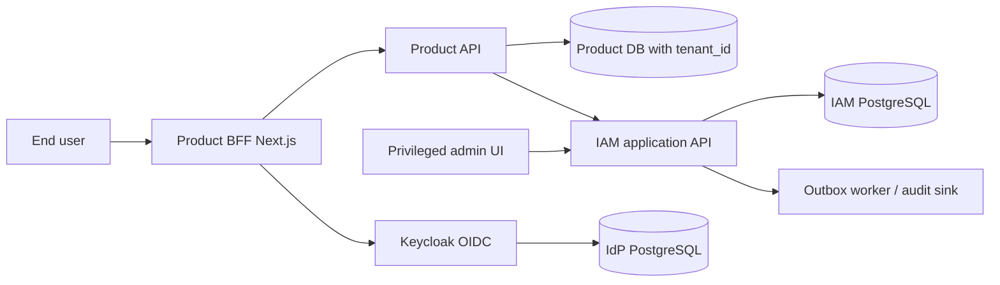

# Solution architecture
## C4 context and containers

Trust boundaries: public browser to BFF/IdP; internal product API to IAM via authenticated service credential; IAM to its DB; product API to product DB. IdP admin API private only. TLS all edges.

## Identity and request sequences
1. BFF redirects to IdP via authorization code + S256 PKCE, state and nonce; callback verifies state, code exchange and ID token; keeps refresh/access tokens on server, sets session cookie with CSRF defenses.
2. Product API verifies bearer access token via cached OIDC discovery/JWKS: issuer, allowed algorithm, signature, `aud` for that API, time claims, subject; ID token refused. Caching must permit rollover without unknown-kid network amplification.
3. API chooses tenant from route/header, then IAM resolves `(issuer,sub)`, active membership, tenant-product entitlement and permission. API loads resource from its own DB using `(tenant_id,resource_id)` query, rejects mismatch and performs operation inside tenant-scoped transaction. No caller-supplied owner/amount can become an authorization fact.
4. IAM service only answers membership/permission; it does **not** certify product resource ownership. For critical mutations, IAM check hits primary DB with no authz cache. Routine reads cache at most 60 seconds; invalidate on change where possible. If unavailable, deny critical operations; do not fallback to JWT role claim.
5. Role/invite changes persist with audit event + outbox in same transaction; dispatcher delivers at least once with stable event ID; consumer deduplicates. IdP signout and org reconciliation are separate operations and can fail: retry with alert, do not pretend distributed atomicity.

## Data and failure ownership
Keycloak owns credentials, MFA and refresh rotation; do not duplicate. IAM owns membership/roles, and is authoritative even when IdP org claims lag. Products own their resources and tenant boundaries; product DB scoping is mandatory. If IdP unavailable, existing BFF sessions can last only as configured and refresh/new login fails; IAM decisions still need current app DB for critical writes. If IAM unavailable, critical writes fail closed and routine reads default deny for pilot (no stale fallback).

## Explicit non-goals
The service cannot transparently enforce row-level isolation in arbitrary products; every product must install middleware and negative tests. This is a platform contract, not a promise that one central middleware guarantees data isolation everywhere. Include product A and product B integration in G2 release gate.
